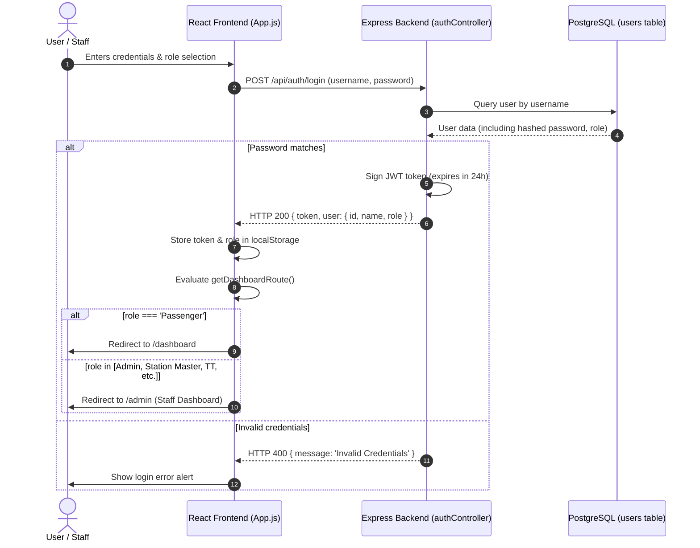
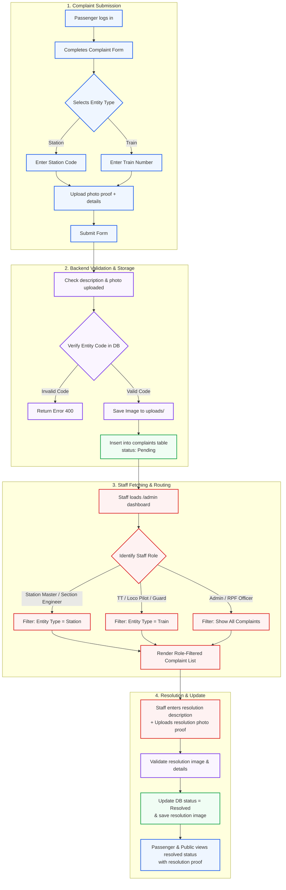
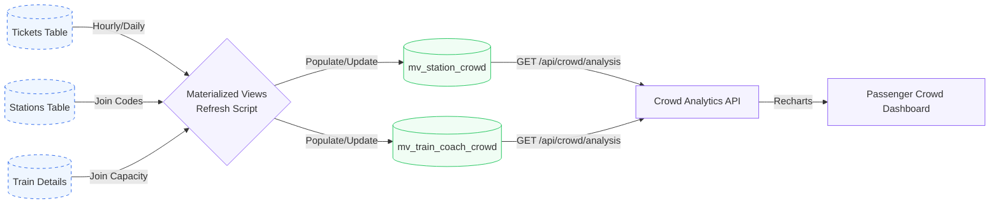

# 🚆 RailPulse — System Architecture & Flow Report

This document outlines the detailed system architecture, user workflows, authentication routing, and data processing flows for the **RailPulse Smart Railway Management System**.

---

## 1. System Architecture & Data Flow

The RailPulse platform consists of a React Single Page Application (SPA) on the frontend, communicating with a Node.js + Express backend. Data is persisted in a PostgreSQL database utilizing materialized views for performance optimizations on crowd monitoring data.

```mermaid
graph TD
    %% Define styles and classes
    classDef client fill:#f9fbfd,stroke:#3b82f6,stroke-width:2px,color:#1e3a8a;
    classDef server fill:#f5f3ff,stroke:#8b5cf6,stroke-width:2px,color:#4c1d95;
    classDef db fill:#f0fdf4,stroke:#22c55e,stroke-width:2px,color:#14532d;
    classDef storage fill:#fffbeb,stroke:#f59e0b,stroke-width:2px,color:#78350f;

    subgraph Client ["Client Side (React SPA)"]
        A[React Frontend]:::client --> B(Axios API Service):::client
        B --> C{Route Guard}:::client
        C -->|Passenger| D[/dashboard]:::client
        C -->|Staff/Admin| E[/admin]:::client
        C -->|Public/Guest| F[/public-complaints]:::client
    end

    subgraph Server ["Server Side (Node.js + Express)"]
        G(Express Server):::server --> H{JWT Authentication}:::server
        G --> I[Multer Middleware]:::server
        
        %% Controllers
        H --> J[Auth Controller]:::server
        H --> K[Complaint Controller]:::server
        H --> L[Crowd Controller]:::server
    end

    subgraph Storage ["Storage Layer"]
        M[(PostgreSQL Database)]:::db
        N[(Materialized Views)]:::db
        O[Local uploads/ directory]:::storage
    end

    %% Flow lines
    B <-->|HTTP Request / JWT Auth Header| G
    J <-->|Query/Insert Users| M
    K <-->|Query/Insert/Update Complaints| M
    L <-->|Query Crowd Data| N
    I -->|Save Photo Proofs| O
    A <-->|Fetch Static Assets| O
```

---

## 2. Authentication & Role-Based Routing Flow

User access is protected via role-based JWT authentication. Depending on the assigned role stored in the token payload, users are automatically directed to their designated portal.



---

## 3. Complaint Lifecycle Flow

Complaints submitted by passengers go through validation, photo attachment handling, automatic assignment based on entity tagging (Station/Train), role-based staff filtering, and mandatory-proof resolution.



---

## 4. Crowd Monitoring & Analytics Pipeline

To provide lightning-fast query times on ticket and occupant analytics, the database leverages PostgreSQL materialized views which are periodically refreshed via server maintenance scripts.

